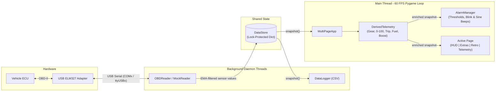

# R36S Car Dashboard (`CarDataReader2`)

A real-time automotive OBD-II HUD and telemetry dashboard built with Python and Pygame, tailored for 640x480 handheld Linux consoles such as the **R36S** (running Armbian via KMS/DRM or X11) as well as desktop environments for development and testing.

Communication with the vehicle ECU uses a **wired USB ELM327 / OBD-II serial interface** for low-latency, deterministic polling without wireless pairing or network overhead.

---

## Architecture Overview

The application decouples slow/blocking serial I/O and disk writes from the 60 FPS UI loop using a producer-consumer model backed by a thread-safe in-memory state container (`DataStore`).



### Threading & Execution Model

| Thread | Module | Responsibility |
| :--- | :--- | :--- |
| **Main Thread** | `main.py` / `dashboard/multi_app.py` | Runs the 60 FPS Pygame event, telemetry derivation, alarm evaluation, and rendering loop. Never blocks on serial I/O or file writes. |
| **Ingestion Thread** | `obd/reader.py` (`OBDReader`) or `obd/mock.py` (`MockReader`) | Discovers the USB serial adapter, maintains reconnection loops, polls OBD-II PIDs at prioritized intervals, applies Exponential Moving Average (EMA) smoothing, and writes values into `DataStore`. |
| **Logging Thread** | `obd/logger.py` (`DataLogger`) | Periodically snapshots `DataStore` (default `1.0 s`) and flushes timestamped rows to `logs/session_YYYY-MM-DD_HH-MM-SS.csv`. |

---

## Core Subsystems

### 1. Wired USB OBD-II Ingestion (`obd/reader.py`)

#### Automatic USB Port Discovery (`find_obd_port`)
When `OBD_PORT = "auto"` in `config.py`, `OBDReader` scans connected serial interfaces in four passes:
1. **Known USB VID/PID match**: FTDI (`FT232R`), WCH (`CH340`/`CH341`/`CH9102`), Silicon Labs (`CP2102`), Prolific (`PL2303`), and Espressif native USB.
2. **Descriptor / Hardware ID keywords**: matches USB-serial and ELM327/OBDLink strings.
3. **Linux device node fallback**: selects `/dev/ttyUSB*` or `/dev/ttyACM*`.
4. **Single-port fallback**: selects the sole serial port if only one exists on the host.

If the cable is unplugged or the ignition is turned off, `OBDReader` marks `connected = False`, closes the port cleanly, and retries every few seconds without crashing the UI.

#### Multi-Tier PID Polling
Because ELM327 serial round-trips limit total query throughput, commands are scheduled in three priority tiers per cycle:
- **Fast (Every cycle)**: `ENGINE_SPEED` (`rpm`), `VEHICLE_SPEED` (`speed`), `THROTTLE_POSITION` (`throttle`), `INTAKE_MAP` (`map_kpa`).
- **Medium (Every 8 cycles, ~1 s)**: `ENGINE_COOLANT_TEMP` (`water_temp`), `ENGINE_OIL_TEMP` (`oil_temp`), `VEHICLE_VOLTAGE` (`voltage`), `ENGINE_LOAD` (`load`), `INTAKE_AIR_TEMP` (`intake_temp`), `MAF_RATE` (`maf`).
- **Slow (Every 40 cycles, ~5 s)**: `FUEL_LEVEL` (`fuel`).

#### Signal Smoothing (EMA Filter)
Raw sensor readings pass through a per-metric Exponential Moving Average (`val = alpha * raw + (1 - alpha) * prev`):
- Instantaneous metrics use high `alpha` (`rpm = 1.00`, `speed = 0.75`, `throttle = 0.60`, `map_kpa = 0.60`).
- Slow or noisy sensors use low `alpha` (`water_temp = 0.20`, `voltage = 0.25`, `fuel = 0.03` to suppress tank sloshing).

---

### 2. Shared State (`obd/store.py`)
`DataStore` wraps a dictionary with a `threading.Lock`:
- `set(key, value)` updates a single metric atomically from the reader thread.
- `snapshot()` returns a shallow copy of all current metrics so the UI and CSV logger work on a consistent frame snapshot without holding the lock during rendering.

---

### 3. Derived Telemetry Engine (`dashboard/telemetry.py`)
`DerivedTelemetry` runs once per frame inside `MultiPageApp` (independent of which page is currently displayed) and enriches the `DataStore` snapshot with pure-Python calculated metrics:
- **`GearEstimator`**: infers the engaged gear (`0` = neutral/stopped, `1`–`5`) from the `RPM / km/h` ratio table (`GEAR_RPM_PER_KMH`) using logarithmic tolerance and a `0.35 s` stability hysteresis to ignore clutch slip during shifts.
- **`ZeroToHundred` ("Berserk Timer")**: automatic 0–100 km/h sprint state machine (`WAIT_STOP` → `READY` → `RUNNING` → `DONE`) with linear sub-frame timestamp interpolation on start and target crossings, abort detection, and persistent best-time storage (`logs/best_0_100.json`).
- **Instant Fuel Consumption (`km/l`)**: computed from Mass Air Flow (`MAF`), stoichiometric air-fuel ratio (`FUEL_AFR`), and gasoline density (`FUEL_DENSITY_G_L`), smoothed with a 2-second time constant.
- **Turbo / Manifold Boost (`bar` & `psi`)**: derived from `map_kpa - BAROMETRIC_KPA`.
- **Trip Timer**: accumulates engine-on driving time whenever `connected` is true and `rpm >= TRIP_ENGINE_ON_RPM`.

---

### 4. Multi-Page UI & Global Alarms (`dashboard/`)

`MultiPageApp` (`dashboard/multi_app.py`) manages a `CONNECTING` → `DASHBOARD` state machine, gamepad/keyboard navigation (D-pad Left/Right, L1/R1, or Left/Right arrow keys to switch pages; `A` button/key to exit), global alarms, and four `Page` implementations (`dashboard/page_base.py`):

1. **`HudPage` (`dashboard/page_hud.py`)**: Clean digital speedometer arc, rolling temperature history graph, and battery voltage bar.
2. **`ExtrasPage` (`dashboard/page_extras.py`)**: Dedicated oil and coolant temperature gauges, vehicle voltage gauge, R36S console battery indicator, and active USB port badge.
3. **`RetroPage` (`dashboard/page_retro.py`)**: Classic Doom-inspired status HUD featuring modular widgets (`dashboard/widgets/doom/`) and reactive Doomguy expressions based on speed and coolant temperature thresholds.
4. **`TelemetryPage` (`dashboard/page_telemetry.py`)**: High-density procedural steampunk/Doom telemetry cluster pre-rendering static metal plates, rivets, and supersampled circular dials once at startup, then drawing anti-aliased needles, shift light, warning lamps, TPS/Load bars, Boost/Fuel bars, Gear indicator, Berserk 0–100 timer, Trip timer, and Fuel Economy at 60 FPS.

`AlarmManager` (`dashboard/alarm.py`) evaluates oil temperature, coolant temperature, and battery voltage every frame, driving synchronized warning (1 Hz) / danger (2 Hz) blinking borders and procedurally synthesized sine-wave audio alerts (`ALARM_SOUND` in `config.py`).

---

## Project Structure

```text
.
├── config.py                  # Display, USB serial, thresholds, and telemetry constants
├── main.py                    # Standard entry point (starts MultiPageApp on START_PAGE)
├── main_extras.py             # Entry point with global unhandled-exception file logging
├── app_log.py                 # Rotating session diagnostic/error logger (logs/errors_*.txt)
├── start.sh                   # Armbian / R36S launch script (KMS/DRM or X11 + dialout setup)
├── install_autostart.sh       # Systemd service installer for automatic boot into TTY1
├── obd/
│   ├── reader.py              # USB serial auto-discovery, tiered OBD-II polling & EMA filter
│   ├── mock.py                # Synthetic sensor generator for offline development (MOCK_MODE)
│   ├── store.py               # Thread-safe DataStore shared between threads
│   └── logger.py              # Background CSV session recorder (logs/session_*.csv)
├── dashboard/
│   ├── multi_app.py           # 60 FPS state machine, input router, and page switcher
│   ├── page_base.py           # Abstract Page lifecycle (update, draw, chrome, alarms)
│   ├── page_hud.py            # Page 0: Main HUD
│   ├── page_extras.py         # Page 1: Oil/Coolant/Voltage & Console Battery
│   ├── page_retro.py          # Page 2: Doom Retro HUD
│   ├── page_telemetry.py      # Page 3: Full OBD-II Telemetry Cluster
│   ├── telemetry.py           # GearEstimator, ZeroToHundred, Boost, Trip & Fuel math
│   ├── alarm.py               # Threshold evaluator, blink timer & procedural audio beeps
│   └── widgets/               # Reusable gauge, bar, graph, and Doom-themed UI components
├── assets/                    # Sprites, backgrounds, and tachometer textures
└── fonts/                     # Custom TrueType fonts (DooM.ttf)
```

---

## Getting Started

### 1. Install Dependencies

```bash
python -m venv .venv
# Windows
.venv\Scripts\activate
# Linux / Armbian
source .venv/bin/activate

pip install -r requirements.txt
```

### 2. Configure (`config.py`)

Key settings in `config.py`:
- `MOCK_MODE`: set to `True` to simulate sensor data without a vehicle or USB adapter, or `False` for live USB OBD-II polling.
- `OBD_PORT`: `"auto"` to automatically detect the USB ELM327 adapter, or an explicit port such as `"COM3"` (Windows) or `"/dev/ttyUSB0"` (Linux).
- `OBD_BAUD`: serial baud rate (default `38400`; common alternatives are `115200` or `9600`).
- `FULLSCREEN`: `True` for R36S / dedicated screens, `False` for windowed desktop testing.

### 3. Run

**Desktop (Windows / Linux):**
```bash
python main.py
```

**R36S / Armbian (KMS/DRM direct framebuffer):**
```bash
chmod +x start.sh
./start.sh
```

**Enable Automatic Boot on Armbian (`systemd`):**
```bash
chmod +x install_autostart.sh
./install_autostart.sh
```
